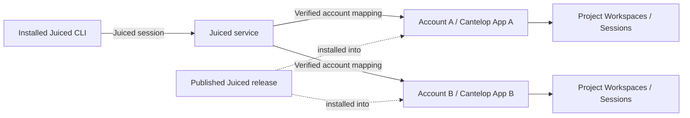

# Managed Juiced multitenancy

Status: architecture proposal; the managed service described here is not implemented.

The [full implementation plan](multitenancy-implementation.md) defines the proposed
contracts, work sequence, tests and rollout. It incorporates the confirmed GitHub
and Google sign-in and subscription-with-included-usage/hard-cap requirements.

Juiced will manage infrastructure and billing. End users sign in to Juiced and
do not need a Cantelop account, the Cantelop CLI, Docker, or a source checkout.
This is the product direction confirmed during the design discussion.

## Recommendation

Give each Juiced account its own Cantelop App. Keep the current per-project
Workspaces and per-conversation Sessions inside that App. All accounts install
the same published Juiced release, with independent configuration, credentials,
activation state, and durable data.

An account is the tenant. Initially each user has one personal account. Keeping
the account identity separate from the sign-in identity leaves a path to teams
without changing the infrastructure hierarchy. Apps belong to the Juiced
operator in Cantelop; Juiced owns the account-to-App authorization mapping.



The service creates Apps and installs releases on behalf of accounts. A separate
request relay handles CLI traffic. These can initially share a deployment, but
only provisioning workers need infrastructure administration credentials.

An App is an authorization and configuration boundary. This does not imply a
dedicated host or a permanently running VM per user. Cantelop allocates Sandboxes
for Sessions; host capacity, storage isolation, and noisy-neighbor controls need
their own validation.

## What the current code establishes

The following observations come from the local Juiced, Cantelop, and SDK sources:

| Observation | Consequence |
| --- | --- |
| Juiced declares `name: 'juiced'` in `src/cantelop.ts`; its CLI imports that App directly. | Installed CLIs currently select the same named deployment rather than a Juiced account. |
| Cantelop documents an integration token as authorizing every Workspace and Session of one App (`docs/openapi-console.yaml`, `/v1/apps/{id}/integration`). | Sharing one App credential with unrelated users defeats Workspace-level isolation. |
| `GH_TOKEN` is declared on the App and configured by `src/environment.ts` and `src/github-configure.ts`. | Distinct Apps give different accounts independent GitHub configuration without redesigning secrets as per-Workspace values. |
| Claude authentication and settings live in each Workspace. | Preserve this behavior; App-per-account does not automatically make Claude login account-wide. |
| Cantelop App slugs are globally unique (`console/core/db/schema.ts`, `apps_routable_slug`). | Generate opaque deployment slugs; all users cannot deploy a physical App named `juiced`. |
| The SDK compiler includes the App name in its runtime hash (`src/compiler.ts`). Cantelop compares manifest `app_name` with the target App slug (`console/core/configuration/repository.ts`). | A release cannot currently be installed unchanged into differently named Apps through the normal deployment path. |
| The SDK already accepts an App-bound `connection.fetch(Request)` (`src/integration.ts`, `src/edge-connection.ts`). | The CLI can talk through an authenticated Juiced relay while retaining its compiled runtime and typed protocol. |
| Cantelop defaults to five Apps per owner and resolves compute ownership from the App's owner or preserved compute tenant key. | A fleet under one operator needs explicit capacity planning and per-account admission controls; creating more Apps alone does not establish resource quotas. |

These are implementation observations, not a completed isolation audit.

## Identity and authorization

Juiced needs a small backend with a durable database for accounts, sign-in
identities, device sessions, subscriptions/entitlements, installations, and
provisioning operations. Start with a maintained authentication provider/library
and a browser sign-in flow. Link identities by verified provider subject through
an authenticated linking flow, never by a user-supplied email.

Use a maintained OAuth device authorization flow for V1 desktop and remote CLI
login, with explicit browser approval. A future loopback authorization-code
flow must use state and PKCE, following
[OAuth for native apps, RFC 8252](https://www.rfc-editor.org/rfc/rfc8252.html).
Store a revocable Juiced device credential in the OS credential
store, with a private file fallback where needed. Rotate refresh credentials
and detect replay. Access tokens should be short-lived and audience-bound.

For each request, the backend derives the account from the authenticated
session and checked membership, then looks up its installation. A supplied App
ID, hostname, Workspace ID, email, or slug never selects an arbitrary tenant.
An explicit account selector is only a request to choose an account the session
is authorized to use. Enforce the mapping on every route, including environment
configuration, inspection, deletion, file sync, Git transfers, auth, and streams.

Keep Cantelop owner/service credentials and App integration tokens on the
backend. Never put them in the npm package or return them during CLI sign-in.
Separate staging and production owners, signing keys, installation namespaces,
and credentials. The operator remains capable of accessing its managed Apps;
App-per-account isolation does not remove this administrative trust.

## CLI and request relay

The intended first-run experience is:

```sh
npm install -g juiced
juiced login            # Juiced identity, entitlement, and account provisioning
juiced claude login     # Existing Claude sign-in inside this project's Workspace
juiced claude
```

`juiced login` would become the Juiced account command. The current parser rejects
it as a moved Claude command, so update that message and its tests. Keep
`juiced claude login` as the separate Claude authentication operation. Add
`juiced logout` and `juiced whoami` for device/account management. Interactive
launches can guide an unsigned-in user through account sign-in; piped commands
must return an actionable error without starting an unexpected prompt.

Use the existing SDK `AppConnection` to send requests to the Juiced relay. The
relay authenticates the Juiced session, checks account status, resolves the App,
and adds that App's integration credential to the upstream request. Permit only
the known public SDK protocol routes and methods. Do not accept an arbitrary
upstream URL or caller-selected infrastructure headers. Use the canonical Edge
origin from trusted installation metadata and do not follow redirects carrying
credentials. SDK 1.4.0 environment commands use the same validated connection;
the relay applies account permissions to those operations too.

Preserve message IDs, request bodies, runtime compatibility headers, errors,
AbortSignals, and SSE response streaming. Retries must preserve the existing
delivery identities, and no proxy layer may buffer an entire event stream. File
sync and Git transfer limits/backpressure need explicit coverage. Restrict
request logging to metadata; prompts, code, token values, and Claude sign-in
codes must not enter access logs.

The existing Claude browser-terminal flow returns a short-lived, single-use
App/Workspace terminal ticket. It can continue to connect directly to that
terminal after an authorized ticket request. Test its origin, scope, expiry,
and suspension behavior separately; it must not expose an App integration token.
The managed CLI's existing direct database cleanup also moves behind a narrow
service operation so provider database tokens do not bypass device revocation.

Revoking a Juiced device session blocks subsequent requests and closes its relay
streams within a defined bounded interval. Bound stream authorization by token
expiry/revocation checks, with normal reconnection through refreshed credentials.
Signing out a device does not delete its remote files. Account suspension also
blocks new runtime admission and follows an explicit policy for stopping active
work; it cannot rely only on an expired browser session.

Relaying costs an extra network hop and makes the Juiced service part of stream
availability. Measure prompt latency, concurrent stream capacity, sync throughput,
and reconnect behavior. Remote work must retain its existing independent lifetime
when the relay or laptop disconnects. Later, if those measurements justify it,
Cantelop can accept short-lived delegated App capabilities directly at Edge.
Such a capability must carry a fixed App, audience, expiry, allowed operations,
and revocation policy. Do not ship permanent App tokens as a shortcut to direct
access. Delegated Edge authentication is not required for the initial relay design.

## Cantelop: install a published release into a managed App

Add a reusable release installation primitive. Publish a Juiced runtime and Edge
artifact pair once from CI, pinned by immutable digests and their compatible
runtime identity. Provision each account from that published release.

Keep the logical application definition (`juiced`) separate from the physical
App (`app_*`, with an opaque unique slug). A published package identifies the
logical definition and artifact pair; an installation binds it to an owned App.
The package's runtime fingerprint must still match the CLI and Sandbox. Account
identity must not alter a code/contract fingerprint or require recompilation.

The current compiler can continue fingerprinting a consistently named logical
definition for this path. The platform needs an explicit installed-package
binding when validating deployment configuration. Preserve the existing
name-matches-slug check for ordinary source deployments; do not merely remove
the check globally or trust a caller-supplied manifest with a different name.
Cover any runtime/webhook assumptions about the logical name in package tests.

The installation operation must:

1. Authenticate a machine principal authorized to manage only Juiced's fleet.
   Add revocable service credentials with suitable scopes; a human CLI's 30-day
   refresh token is unsuitable as the production worker credential.
2. Resolve an immutable package version that the operator is authorized to
   install. Never offer arbitrary cross-owner release copying by ID.
3. Create or reuse the App under the Juiced billing owner, enforcing fleet quota
   and the unique installation key. Set only declared nonsecret defaults.
4. Create fresh App integration credentials and new deployment operations using
   verified artifacts. No source App secrets, Workspaces, Sessions, database
   credentials, or user files are copied.
5. Bind App-specific Edge configuration/routing and materialize the runtime under
   the target App's ownership. Reuse verified immutable blobs where supported;
   sharing bytes must not share writable state. Artifact retention must account
   for every installation so deleting a source release cannot strand users.
6. Expose durable operation status and recovery. Repeated calls with the same
   installation/operation identity converge after ambiguous network failures.
   A conflicting identity/payload fails without creating another App.

Pin the package while provisioning; a release published halfway through an
operation must not change its result. The target App gets its own active release
and rollback history. Reuse Cantelop's deployment reconciliation and operation
mechanisms rather than building another deployment engine inside Juiced.

## Provisioning, entitlement, and usage

At minimum, persist:

| Record | Important fields and constraints |
| --- | --- |
| Account | Immutable account ID, active/suspended/deleting status, entitlement reference. |
| Membership | Verified user ID, account ID, role; unique membership. |
| Device session | Hashed refresh credential, user/account binding, expiry, rotation/revocation state. |
| Installation | Account ID, environment, Cantelop App ID, package/runtime version, desired state, observed state, operation ID; unique account/environment and unique App binding. |
| Operation | Stable idempotency key, pinned package, step/status, retry information, sanitized failure code. |
| Usage event | Unique source event ID, account/App/Workspace/Session identity, measured interval/resource, timestamp. |

Create the account/installation intent durably before calling Cantelop. Claim it
with a database constraint/transaction and reconcile an external App through a
stable installation key. A crashed worker, two laptops signing in, or an SDK
retry must not allocate additional Apps. Proposed states are `pending`,
`provisioning`, `ready`, `failed`, `suspended`, and `deleting`, with desired and
observed states recorded separately. Save enough information to retry an existing
operation instead of provisioning from scratch. Avoid a transaction held open
across network calls.

Juiced owns product subscriptions, plan rules, and the billing ledger; Cantelop
reports infrastructure usage by App and enforces runtime admission limits.
Measure actual runtime/storage consumption with deduplicated events, including
work that continues after the CLI disconnects. Do not bill by client heartbeats
or command counts. Apply authenticated billing-provider events idempotently and
reconcile delayed or missing usage events.

Give each App enforceable concurrent Session, compute, storage, and spend limits,
plus an operator-wide fleet limit. Enforce admission in the platform/dispatcher
as well as the Juiced API: queued work, idle-session reactivation, retries, and
detached agents can allocate resources without a fresh CLI request. Plan limits
must define treatment of already-running work and delayed meter events. Use
reservation/admission accounting if promising a hard spending cap; delayed
usage reporting alone cannot guarantee one.

## Versions, upgrades, and account switching

Publish versioned CLI/runtime pairs. The service checks client compatibility
before selecting an installation/release. Do not substitute whatever runtime is
latest for the compiled fingerprint: the current mismatch protection is useful.
Initially require a supported CLI version and perform coordinated App upgrades
when active work has drained, with explicit handling of older installed clients.
Later, concurrent release support requires a real version-routing design.

Canary upgrades and roll back per App. Preserve Workspace data and Claude state;
separate state-schema migrations from binary rollback, since rollback of an
image cannot undo arbitrary persistent data changes.

Capture the selected account and installation once for each command. Switching
the default account in another process must not reroute an in-flight request or
an automatic reconnect. Resolve Workspaces within that fixed App.

Namespace all local state and Git references that can outlive a connection by
service environment, account/installation, and canonical Workspace ID. Existing
terminal bindings already include the canonical Workspace ID in
`src/session-state.ts`; Git imports in `src/git-workspace.ts` and publication
receipts in `src/local-publish.ts` currently use the Workspace slug and need
additional scoping. Verify file-sync pairing through canonical Workspace IDs and
reject switching a local folder to a different account without explicit repair.
An account switch must not auto-apply another account's retained publication or
reuse its import metadata.

## Migration and deletion

Keep existing self-managed deployments usable through an explicit mode/profile
while introducing managed accounts. Once managed mode is selected, missing or
expired Juiced credentials must fail rather than fall back to an ambient
Cantelop integration profile. Managed and self-managed targets need distinct
local namespaces.

An existing `juiced` deployment is not evidence of which end user owns its data.
Require a verified administrative claim/migration procedure for existing data,
and an explicit backup/restore or supported App adoption path. Preserve canonical
IDs where possible; otherwise migrate or retire local bindings intentionally.
Do not silently attach every new Juiced account to the legacy App, copy its
GitHub secrets to new Apps, or delete it after the first migration.

Account deletion is a durable operation: revoke devices, block admission, stop
work, purge Workspaces/databases, archive the App, and reconcile partial failures.
Define retention for backups, billing records, and audit metadata separately.
App archival alone is not evidence that durable workspace data was purged.

## Implementation order and release criteria

1. **Cantelop fleet primitives:** service credentials, authorized immutable
   packages/installations, target-App deployment binding, reconciliation,
   retention, per-App usage and admission. Test isolated installs of the same
   package under one operator.
2. **Juiced service:** verified identity, accounts, device auth, installation
   mapping, durable provisioning worker, entitlement checks, billing ledger,
   usage reconciliation, and revocation-aware streaming relay.
3. **CLI:** managed login/logout/whoami, account-bound `AppConnection`, explicit
   self-managed mode, local state scoping, installable package contents and
   release automation. The current `package.json` is private; publishing also
   needs a verified package name/registry, licensing decision, and package smoke
   tests outside the source checkout.
4. **Production qualification:** two real accounts, separate credentials and
   files, concurrent provisioning/retries, quota enforcement, fleet upgrades,
   deletion, network recovery, and realistic stream/sync load.

Initially use the SDK's existing connection seam; no new SDK tenancy abstraction
is required just to route a managed CLI. Add SDK control-plane clients or
delegated credentials only when implementing a concrete platform contract, with
contract tests across platform, SDK, and CLI.

Acceptance must demonstrate that account A cannot read, resume, inspect, sync,
publish from, configure, authenticate to, or delete account B's resources using
either slugs or copied canonical IDs. Include identical project slugs and attempts
to reuse Session IDs across Apps; existing global-ID collisions may safely fail
without accessing the other App. Verify mismatched runtime rejection, revoked/expired
device credentials, unknown App IDs, forged routing headers, terminal tickets,
and non-enumerating errors. Verify App integration credentials never appear in
the installed package, managed configuration, CLI responses, or logs.

Operational acceptance also needs provisioning recovery after every external
step, one App for simultaneous logins, independent `GH_TOKEN` rotation, bounded
stream revocation, budget enforcement during detached work, complete deletion,
and a tested rollback. Until these paths exist and pass, the current CLI remains
a self-managed development client rather than a managed multitenant product.
